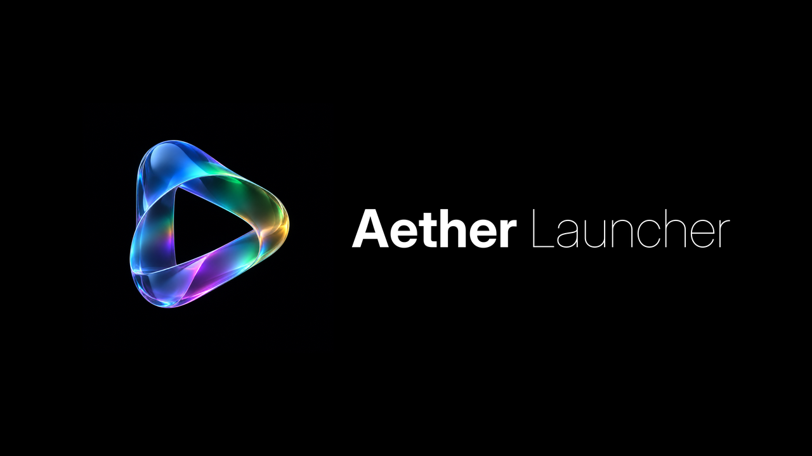

<p align="center">
  
</p>

<h1 align="center">Refract Custom</h1>

<p align="center">
  A personal Android TV launcher with a tvOS-inspired Home screen, glass controls,
  and a remote-first interface.
</p>

<p align="center">
  <a href="https://github.com/arinaggarwal1/refract-launcher/releases/latest">Download a release</a>
  &nbsp; · &nbsp;
  <a href="docs/features.md">Explore features</a>
  &nbsp; · &nbsp;
  <a href="docs/updating-your-launcher.md">Update your TV</a>
  &nbsp; · &nbsp;
  <a href="docs/README.md">Documentation</a>
</p>

<p align="center"><strong>Android 7.0+ (API 24)</strong> · Java 11 · No Gradle or third-party runtime libraries</p>


Refract Custom is a personal fork of **Refract Launcher by Hydrainnit**, itself based on
[Hume Launcher](https://github.com/petrobot-admin/hume-launcher) by Petrobot. It brings a
TV-friendly dock, personalized content, search, and device controls together on one Home screen.
This fork uses the separate application ID **`com.arinaggarwal.refract`** and its own permanent
signing identity. It is not an in-place update for the original launcher.

## At a glance

| | |
|---|---|
| **Home, your way** | A glass dock, app grid, folders, per-profile layouts, light and dark themes, and rotating backgrounds. |
| **Content up front** | Continue Watching, news, recommendations, and an optional Movies tab and Home theme. |
| **Find things fast** | Search apps, settings, inputs, movies, and shows; use the TV keyboard or supported voice input. |
| **Control Center** | Wi-Fi, Bluetooth audio, Do Not Disturb, sleep timer, power, memory, inputs, and settings. |
| **Weather & Ambient** | A forecast card and photo or movie screensaver with clocks and credits. |
| **Presentation mode** | Send images, videos, and webpages from a browser to a full-screen TV player. |
| **Profiles** | Up to three profiles, each with its own Home layout, background, and content choices. |
| **TV-side updates** | Check published releases from Settings, verify the download, and install with Android's confirmation screen. |

| Home in Light | Weather |
|---|---|
|  |  |
| Search | Settings |
|  |  |

*These screenshots come from the Android TV emulator and may show earlier interface versions.
Artwork belongs to its respective owners and is fetched at runtime.*

## Using Refract

Navigate with the D-pad and press **OK** to select. Hold OK on an app for its options, including
moving it or adding it to a folder. Hold **Back** on Home to open Search; a short press goes back.
The status row opens Search, Settings, Control Center, and profiles. Home closes overlays and returns
to the first dock app.

Control Center includes glass Wi-Fi and Bluetooth panels. On Fire OS 7, the Wi-Fi panel can scan
for networks with Location permission and connect to supported networks; Bluetooth audio controls
can connect or disconnect paired audio devices. Other security types, devices, and Android versions
may require the TV's own settings. Audio routing and network controls depend on the device; the
new Wi-Fi panel has not yet been verified on the Fire TV Cube.

The Inputs picker uses inputs exposed by Android's TV input framework. A Fire TV Cube does not
expose the television's separate HDMI ports as its own inputs. A separately installed **Refract
Remote** companion can map a remote button to open Control Center over another app; it has its own
setup and is not part of this launcher APK.

See the [feature guide](docs/features.md) for the full tour, permissions, and screenshots. For
browser uploads and playback, see [Presentation mode](docs/presentation.md).

## Install and update

### Already using this fork?

On the TV, open **Settings → About → Check for Updates**, download an available release, and
confirm installation in the system installer. The updater checks the release metadata, package,
checksum, and signing certificate. If asked, allow Refract to install unknown apps in TV settings.

An in-place update with the same package and signing key keeps the launcher's app data, including
profiles, layouts, preferences, and Keystore-backed API keys. Do not uninstall or clear data to
resolve a signing or version error. The [update guide](docs/updating-your-launcher.md) covers the
TV-side and computer-assisted paths, troubleshooting, and recovery.

### First install

Download `refract-custom.apk` from [Releases](https://github.com/arinaggarwal1/refract-launcher/releases)
and install it through a method supported by your device. Follow the on-screen setup and the
[install guide](docs/install.md) for Home selection and optional permissions. Availability of Home
selection and permissions varies by TV and firmware.

**Your Fire TV Cube:** Refract Custom is already installed and selected as Home. The original
`com.hydrainnit.refract` was uninstalled after backup, so the old rollback command alone cannot
restore it. Do not repeat the historical migration or change the already-disabled Amazon Home
components. [Details and recovery](docs/custom-updates.md).

## What root adds

Root is **not required** for Refract's ordinary Home screen, Control Center, search, or presentation
features. Android permissions and the device's own capabilities still determine what is available.
The launcher itself does not automatically request root.

On a rooted device, the optional, explicitly invoked TV helper can access another app's private
files for a backup or a guarded one-time migration, and can attempt to set the preferred Home
activity. Those are maintenance operations, not automatic launcher features. In-place updates and
the on-TV updater do not require root. Root also does not automatically unlock private Amazon APIs,
provide direct access to every TV HDMI input, or bypass Android's other restrictions.

The [root and Fire TV guide](docs/guides/root-and-fire-tv.md) explains what is supported, what
requires a separate companion, and the limits of the historical migration tools.

## Build from source

The signed build is intended for this personal fork and needs the **existing permanent signing
key** plus GitHub CLI authentication with repository write access. Each build reserves a unique
increasing version code in GitHub; it does not install anything on a TV.

```sh
# JDK 17+, Android SDK build-tools 36.0.0 and platform android-35
# Restore the existing signing directory and authenticate gh first.
./build.sh
# build/refract-custom.apk, build/SHA256SUMS, build/release.json
```

The key and password live outside Git in `~/.config/refract-launcher/signing` (or the configured
`REFRACT_SIGNING_DIR`). Keep an encrypted offline backup. Never generate a replacement for the
existing installation or reset the `refract-build/*` reservation tags. See
[build and signing](docs/custom-updates.md) and [developer setup](docs/getting-started.md).

When you explicitly want to install an update from a computer, select the device by serial:

```sh
adb devices -l
python3 tools/tv.py --serial TV_IP:5555 install build/refract-custom.apk
```

Replace `TV_IP:5555` with the intended device. The helper checks the APK package, certificate,
and version before installing; it does not change the preferred Home activity.

## Project guide

| I want to… | Start here |
|---|---|
| Learn the interface and controls | [Features](docs/features.md) |
| Install, update, or recover | [Install](docs/install.md) · [Updating](docs/updating-your-launcher.md) · [Signing and migration](docs/custom-updates.md) |
| Understand root and Fire TV support | [Root and Fire TV](docs/guides/root-and-fire-tv.md) |
| Use Presentation mode | [Presentation guide](docs/presentation.md) |
| Find code, resources, and tests | [Repository map](docs/reference/repository-map.md) · [Architecture](docs/architecture.md) |
| Build or contribute | [Getting started](docs/getting-started.md) · [Contributing](CONTRIBUTING.md) |

The [documentation index](docs/README.md) groups all guides by task.

## Privacy, data, and compatibility

- Optional API keys are saved in app-private preferences using Android Keystore encryption where
  available. Some broken TV keystores require a fallback to app-private, unencrypted storage; see
  [Secrets.java](src/com/arinaggarwal/refract/Secrets.java). A rooted device can expose app data.
- The updater uses this repository's public GitHub releases. Weather, recommendations, search,
  artwork, and Presentation mode contact their respective services or local network when used.
- This fork targets Android API 34, compiles against API 35, and supports API 24 and newer. The
  personal target is a Fire TV Cube 3rd gen running Fire OS 7 / Android 9. Behavior and performance
  vary by device; emulator screenshots are not proof of hardware compatibility.
- Permission-dependent features request access through Android's prompts or settings where
  available. Some TVs omit these screens or restrict particular features.

## Credits & license

Refract builds on Hydrainnit's Refract Launcher and Petrobot's Hume Launcher. It includes the
Inter typeface and Nayuki's QR code generator, and uses third-party content and data services.
See [ATTRIBUTIONS.md](ATTRIBUTIONS.md) for authors, licenses, image credits, and data sources.

Licensed under [Apache 2.0](LICENSE); see [NOTICE](NOTICE).
